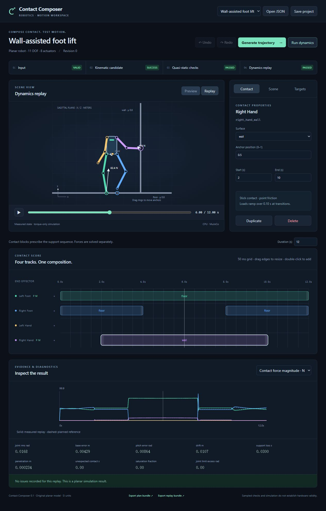

# Contact Composer

Author when a planar robot's hands and feet touch the environment, solve a slow reference motion, and test it in an independent torque-driven MuJoCo replay.

The four contact tracks support drag, resize, anchor picking, numeric edits, duplicate/delete, and 100-step undo/redo. The scene, contact loads, force/torque plots, diagnostic timestamps, and project revisions stay connected. Input validation, candidate generation, quasi-static checks, and dynamics replay have separate statuses.



## Run locally

Tested with **Windows, Python 3.12.7, Node 24.14.1**. The numerical core needs no GPU, account, downloaded robot asset, or dataset. Run these commands from this `contact-composer` directory. The lock file records the tested Python environment; `frontend/package-lock.json` pins the editor dependencies.

PowerShell:

```powershell
py -3.12 -m venv .venv
.venv\Scripts\python.exe -m pip install -r requirements.lock
.venv\Scripts\python.exe -m pip install --no-build-isolation --no-deps -e .
cd frontend
npm.cmd ci
npm.cmd run build
cd ..
.venv\Scripts\contact-composer.exe serve
```

Open **http://127.0.0.1:8765**. If that port is occupied, use `serve --port 8766`. Stop with Ctrl+C. This is a source-checkout application: the editable installation locates `frontend/dist` beside the Python package. Building the frontend is required for the editor; the CLI works without it.

On Linux, use `python3.12 -m venv .venv`, activate `.venv/bin/activate`, and use `python`, `npm`, and `contact-composer` for the same commands. Linux execution has not been verified in this contribution.

For frontend development, start the API on port 8765 and run `npm run dev` in `frontend`. Vite serves port 5173 and proxies `/api` to the local service.

## Try the composition

1. Keep the **Wall-assisted foot lift** example selected. Generate a trajectory, then run dynamics.
2. Scrub to 6 seconds. The right hand supports the wall while the right foot is lifted. Preview shows planned states; Replay shows measured states and forces.
3. Select the violet contact block. Move it, resize its edges, edit its start/end, or drag its anchor ring along the wall. Each completed gesture is one undo transaction.
4. Regenerate after edits. Old results remain available for export but are labeled stale and cannot be replayed against the changed document.
5. Open the Scene or Targets tab to edit friction, force caps, obstacles, swing clearance, or hard/soft pose targets. Click a diagnostic to seek its reported time.

Double-click an empty track or use its `+` button to create a one-second block. Duplicate inserts a copy after a 0.20-second gap; an overlap or interval beyond the project duration is rejected. Ctrl/Cmd+Z undoes, Ctrl/Cmd+Shift+Z redoes, Ctrl/Cmd+D duplicates, and Delete removes the selected block. `P` and `M` indicate planned load and measured support.

Save/Open JSON preserves authored data. Browser refresh starts the bundled example: save edits before refreshing. There is no cloud storage or automatic upload. Result bundles are downloaded separately and retained in `runs/`. Jobs are session-local; exported CLI bundles can be replayed after restarting.

## Headless use

With the environment active:

```text
contact-composer validate examples/wall-assisted.json
contact-composer solve examples/wall-assisted.json --output runs/demo-plan
contact-composer replay examples/wall-assisted.json --trajectory runs/demo-plan --output runs/demo-replay
contact-composer example standing --output runs/my-standing.json
```

Output directories must be new. A solve/replay writes evidence even when checks fail. Exit codes are `0` for passed results or valid input, `2` for computation that did not pass, and `1` for invalid input/I/O errors. JSON diagnostics go to stdout.

Each result contains `project.json`, `model.xml`, `arrays.npz`, `summary.json`, and `manifest.json`. The manifest records checksums, array shapes, model/actuator ordering, package versions, and force conventions. Load arrays with `numpy.load(path, allow_pickle=False)`; imported plans are independently checked before replay. All settings and the revision participate in the project hash.

## Model and numerical scope

The original 8.98 kg robot has an unactuated planar base `(x, z, pitch)` and eight actuated limb joints. End effectors are frictional points represented by small spheres. Feet have no contact moment. Physical parameters originate in the Python model; the editor consumes its manifest.

Generation uses exact two-link IK when it satisfies the requested endpoints, then bounded nonlinear pose search when needed. A force QP checks all 11 generalized equilibrium equations, unilateral forces, Coulomb friction, load ramps, and torque limits. A nonlinear coupled fallback may change posture. Solver failure concerns that attempt or fixed pose; it does not prove every posture impossible.

Candidates are constructed at 100 Hz, including all 50 ms event ticks. Independent validation recomputes geometry, forces, rates, derivatives, and a 5% gravity-scaled inertial screen. Additional geometry checks evaluate interpolated midpoints near surfaces or rapid pose changes. This is sampled validation, not a continuous-time certificate.

Replay initializes the authored state once, steps MuJoCo at 2 ms, and computes bounded commands every 10 ms. The default controller solves a constrained inverse-dynamics QP for the eight actuators. It uses measured state and planned contacts, with no base actuator, teleportation, settling period, or hidden support force. The optional `joint_pd` controller supports comparison. Actual contacts and support losses are measured separately from the planned schedule.

The supplied 12-second demo passes replay. A fixed-pose test verifies that its peak pose loses static support when the necessary hand contact is removed. The `low-friction` example illustrates a difficult composition; local solver failure is not global infeasibility. See [validation and module debugging](docs/DEBUG_LOG.md).

Collision checks cover robot/environment and endpoint/torso pairs. Overlapping planar limb projections are deliberately excluded from self-collision. Current limits include one built-in robot, stick contacts, local pose search, sampled checks, and no hardware interface.

## Test and inspect

```text
python -m pytest -q --basetemp runs/pytest
ruff check src tests --select F,I
ruff format --check src tests
```

From `frontend`:

```text
npm test
npm run build
npx --no-install prettier --check src vite.config.ts
```

Individual Python modules have `tests/test_m01_...` through `test_m10_...` checks. M03 editor tests are in `frontend/src/editor.test.ts`; browser checks are recorded in the log. Windows API tests require local socket pairs and subprocesses. A restricted sandbox can block those before an API request; the app binds only to loopback.

- [Product requirements](docs/REQUIREMENTS.md)
- [Implemented modules and API](docs/MODULES.md)
- [Independent debugging evidence](docs/DEBUG_LOG.md)

Original source and primitive model use the repository's [Apache License 2.0](../LICENSE). No third-party model, image, motion dataset, or copied implementation is bundled. External libraries are installed through package managers and retain their own licenses.
