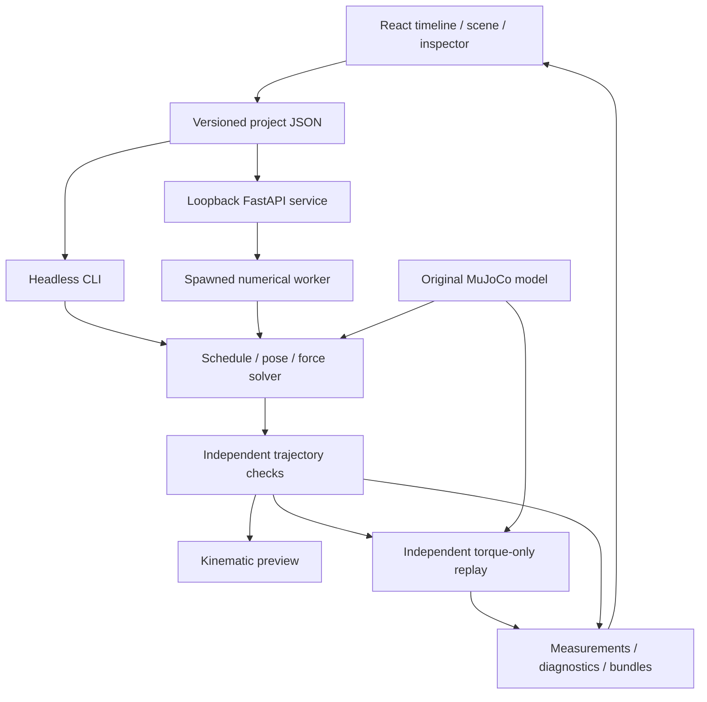

# Contact Composer — Implemented Modules and Interfaces

Version 0.1 | 2026-10-26. See [requirements](REQUIREMENTS.md), [usage](../README.md), and [executed checks](DEBUG_LOG.md).

## Architecture

The numerical core has no HTTP/frontend dependency. Every worker receives an immutable project snapshot. Results are bound to its complete hash, including revision, model identity, controller settings and thresholds.

## Module map

| Module | Implementation | Functions and independent checks |
| --- | --- | --- |
| M01 Project | `project.py`, `editor.ts` | Strict bounded schema, finite data, references, atomic JSON save, SHA-256, 100-step transactional history. Round-trip, invalid imports, overlap and history tests. |
| M02 Model | `spec.py`, `model.py`, `Scene.tsx`, `kinematics.ts` | Original 11-DOF MJCF, FK/Jacobians, gravity, collisions, shared manifest and anchor picking. Numerical derivative and browser/MuJoCo agreement tests. |
| M03 Timeline | `Timeline.tsx`, `Inspector.tsx`, `main.tsx` | Four tracks; tick drag/resize; create/copy/delete; anchors and times; issue markers; planned/measured support; seek/play. Editor tests and browser interactions. |
| M04 Schedule | `schedule.py` | Half-open intervals, terminal left-limit, phase events, force-cap ramps, smooth swing/target tasks. Boundary/continuity/ramp tests. |
| M05 Planner | `planning.py` | Analytic IK, constrained SLSQP, OSQP static forces, coupled pose/force fallback. Generalized equilibrium and fixed-pose failure fixtures. |
| M06 Trajectory | `trajectory.py` | Direct 100 Hz construction, derivatives, independent array/geometry/force/rate/inertia checks, additional geometry midpoints. Corrupted/missing data tests. |
| M07 Replay | `controller.py`, `simulation.py` | Separate MuJoCo state, torque-only stepping, whole-body control or joint PD, actual contacts, cancellation and criteria. Standing, full demo and degraded-controller tests. |
| M08 Diagnostics | `diagnostics.py`, `Diagnostics.tsx` | Scoped evidence, adjacent-issue coalescing, force/torque comparison, metrics and click-to-time reports. Source isolation tests. |
| M09 Service | `service.py` | One spawned worker, polling progress, cancellation, immutable revisions, bounded requests, loopback hosts/origins and downloads. API/process tests. |
| M10 Export | `export.py`, `examples.py`, `cli.py`, `examples/` | New-directory bundles, model XML, checksums, versions, examples and CLI. Round-trip/tamper/no-overwrite/exit-code tests. |

Python paths are under `src/contact_composer`; TypeScript paths are under `frontend/src`. Each module's test commands and outcomes are in the debug log.

## Coordinates and contact semantics

- World coordinates are `(x,z)` in meters; gravity points along negative z. Pitch and limb rotations follow MuJoCo's y-axis convention. Display coordinates invert z only.
- `q/dq/ddq` columns are `base_x`, `base_z`, `base_pitch`, `left_hip`, `left_knee`, `right_hip`, `right_knee`, `left_shoulder`, `left_elbow`, `right_shoulder`, `right_elbow`. Angles are radians.
- The base has three unactuated DOFs. Torques have eight columns in limb-joint order; limits are 45 N·m for legs and 18 N·m for arms.
- Effector order is `left_foot`, `right_foot`, `left_hand`, `right_hand`. Endpoint arrays contain sphere centers. Surface anchors receive a radius offset along the outward normal for center-position constraints.
- Contact forces are **environment-on-robot forces**, in world `(x,z)` coordinates. Static equilibrium uses the actual sphere/surface contact-point Jacobian. The renderer draws arrows at endpoint centers.
- Surfaces have a segment, unit outward normal, friction coefficient and force cap. Constraints are `fn >= 0`, `abs(ft) <= mu*fn`, `fn <= cap(t)`.
- Contacts are active on `[start_tick,end_tick)`. The final sample uses the left-limit active set. Ticks are 0.05 s; duration is 2–20 s; blocks last at least 0.20 s.
- Caps have smooth two-tick entrance/exit ramps. Initial/terminal supports and contiguous identical anchors retain capacity. Different adjacent anchors require a release gap.
- Quintic interpolation with a quartic normal-clearance arch defines swing intent. Prescribed contact and geometric touching are distinct from a measured load.

The manifest enumerates all robot/environment and endpoint/torso collision pairs. Other self-collisions are excluded because limbs share a planar projection. Surface boxes extend 5 cm behind the declared plane. Exported `model.xml` captures the actual model/contact parameters.

## Planning and independent checks

Each 100 Hz sample first attempts exact two-link IK with the requested/current base pose. A candidate must satisfy joint limits, collision checks, hard targets and the force QP. Joint-posture targets use nonlinear search. Otherwise SLSQP searches constrained poses, with a coupled pose/force fallback when the first pose cannot balance.

The static QP solves all 11 equations `g(q) = S^T tau + sum(J_contact(q)^T f)`. Forces/torques are normalized by `m*g`, with the manifest's one-meter characteristic length for moments. Residuals and inequalities are recomputed independently of solver success labels. QP infeasibility concerns that fixed pose; nonlinear failure means no solution was found in that attempt.

Validation checks finite array shapes, full 100 Hz/event coverage, initial pose, derivatives, FK endpoints, scheduled/loaded masks, contact errors, limits, checked collisions, hard targets, equilibrium, inactive zero forces, friction/caps, actuator limits and rates. It screens `M(q)ddq + bias(q,dq) - g(q)` against 5% of the gravity scales. Interpolated midpoint geometry is also checked when a sample is within 2 cm of a surface or generalized-coordinate change exceeds 0.02. The additional sample count is recorded.

Direct construction at 100 Hz replaces the originally proposed 20 Hz seed/refinement stage. Extra midpoints are bounded sampling, not recursive continuous-time certificates. A timeout/cancellation retains partial arrays and an incomplete status. No success label claims hardware validity.

## Independent replay

Replay revalidates numerical arrays, initializes its own `MjData` once, and never assigns poses after initialization. MuJoCo steps at 2 ms; control/logging default to 10 ms. Reference arrays are linearly sampled on the controller clock.

The default whole-body QP solves over 11 accelerations, eight torques and scheduled forces. It enforces measured-state inverse dynamics, friction/caps, acceleration bounds and torque limits. Its objective uses tracking gains 100/20, stronger base weighting, and soft contact acceleration gains 400/40. Explicit weights/gains live in `controller.py`. Only eight actuator commands enter simulation; controller failure stops and fails replay.

The optional `joint_pd` mode uses feedforward torque plus configurable joint gains (defaults 60/1). Project `kp/kd` fields apply to that mode. The complete transition example relies on whole-body control.

Actual forces are transformed from MuJoCo contact frames and signed onto the robot. Records include geometry pairs and separation. Only the intended effector/surface pair contributes to its measured support channel; other sustained loaded contacts fail a separate check.

Criteria: joint RMS <=2°, base error <=3 cm, pitch error <=5°, loaded drift <=2 cm, support loss <=100 ms, penetration <=5 mm, unexpected load <=100 ms, saturation fraction <=5%, joint-limit excess <=0.01 rad. Loaded means planned normal force >2% of weight; presence means measured normal force >1%. Limits are stored with the result. Aggregate replay criteria report their evaluated interval; planning issues report sampled times. No settling, base actuator or hidden support is used.

## Local API and lifecycle

| Endpoint | Contract |
| --- | --- |
| `GET /api/models` | Built-in manifest and ordering. |
| `GET /api/examples` / `GET /api/examples/{name}` | Names or authored project. |
| `POST /api/validate` | Project JSON → status/hash/revision; invalid input gives 422. |
| `POST /api/solve` | Project JSON → 202 job with immutable snapshot identity. |
| `POST /api/replay/{plan_id}` | Same project → replay job; requires a passed matching plan. |
| `GET /api/jobs/{id}` | Status, progress, message, sequence and optional summary. |
| `DELETE /api/jobs/{id}` | Cooperative cancellation; watchdog stops unresponsive cancellation after three seconds on the next poll. |
| `GET /api/results/{id}` | Numerical arrays and summary. |
| `GET /api/results/{id}/download` | ZIP bundle. |

Job states are `running/completed/cancelled/failed`. `completed` means evidence was produced, not checks passed. Inspect numerical `check_status` or replay `status`. Unknown IDs give 404, concurrent/stale requests 409. Requests are bounded to 1 MB and a session to 64 jobs. Nonlocal hosts/origins are rejected. HTTP requests contain no filesystem path or executable model input.

The editor polls every 350 ms using revision and sequence IDs, replacing the proposed WebSocket endpoint. Solver budgets are cooperative; the job watchdog enforces an outer budget when polled. Shutdown cancels/terminates workers. This is a loopback single-user service, not an authenticated network deployment.

## Bundle format 1.0

- `project.json`: authored snapshot.
- `model.xml`: generated MJCF for inspection/reproduction; arbitrary imported MJCF is not executed.
- `arrays.npz`: numerical arrays without pickle/object payloads.
- `summary.json`: statuses, issues, thresholds, metrics and sampling/controller metadata.
- `manifest.json`: identity, shapes, units, dependency versions and SHA-256 checksums of the other four files.

Trajectory arrays: `time_s [N]`, `q/dq/ddq [N,11]`, `tau_reference [N,8]`, `contact_force_world [N,4,2]`, `contact_scheduled/contact_loaded [N,4]`, `endpoint_world [N,4,2]`. Replay arrays: `time_s [R]`, `q_measured/dq_measured [R,11]`, `tau_commanded [R,8]`, `measured_endpoint_world/actual_contact_forces_world [R,4,2]`.

Unknown samples are omitted and coverage/status reported. Inactive forces are true zeros; failed force solves never substitute fabricated zeros. Reference and measured grids remain separate; plots align timestamps, using dashed reference and solid measured traces. Writes use a temporary sibling directory and atomic rename into a new destination. Existing results are not silently overwritten. Imported passed plans are independently validated.
