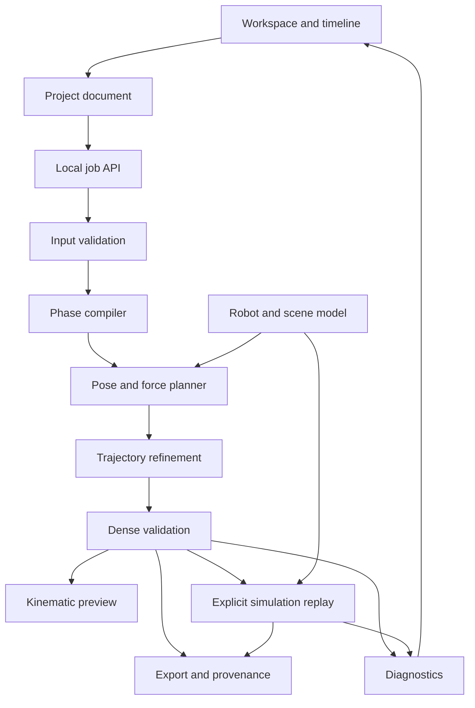

# Contact Composer — Modules and Interfaces

Version: 0.1 draft | Date: 2026-10-26 | Status: proposed design, no implementation

Product requirements and acceptance gates are defined in [REQUIREMENTS.md](REQUIREMENTS.md). All APIs, paths, and commands below are proposed.

## 1. Architecture



The numerical core has no dependency on the web UI or HTTP server. UI state contains authored data and views; the backend owns canonical validation and numerical results. Model parameters have one source of truth for planning and simulation.

## 2. Module responsibilities

| Module | Responsibility and main functions | Inputs → outputs | Requirements |
| --- | --- | --- | --- |
| M01 Project document | Schema, defaults, version checks, IDs, canonical serialization, hashing, save/load; command-based undo/redo on the frontend. | JSON + edits → validated document/revision. | R01, R03, R04, R12 |
| M02 Scene and model | Original robot definition, surface frames, geometry, FK/Jacobians, gravity, collision-pair policy, limit lookup; visual scene and anchor picking. | Robot manifest + scene + q → geometry, dynamics quantities, render data. | R02, R06, R07, R10 |
| M03 Contact timeline | Four tracks; block insertion/move/resize/copy/delete; snapping, numeric edits, selection, issue markers, time navigation. | User events → document commands; result data → overlays. | R03, R09 |
| M04 Schedule compiler | Interval validation, phases, event ordering, active contact sets, approach/swing tasks, force-cap ramps, target interpolation. | Valid project → immutable PhasePlan. | R04, R05 |
| M05 Pose and force planner | Constrained pose search, fixed-pose force/torque QP, warm starts, candidate ranking, solver progress and residuals. | Model + PhasePlan + settings → candidate samples and scoped solver outcomes. | R06, R08 |
| M06 Trajectory and validator | Contact-preserving refinement, time/rate checks, finite derivatives, dense/adaptive sampling, independent residual recomputation. | Candidate samples → TrajectoryResult + ValidationReport. | R07, R08, R09 |
| M07 Simulation and controller | Model initialization, optional disclosed settling, bounded joint control, forward stepping, contact measurement, stop/reset, replay evaluation. | Project + valid candidate + controller settings → ReplayResult. | R10, R11 |
| M08 Diagnostics and plots | Normalize issue records, identify failing intervals/constraints, display residuals and thresholds, compare planned/measured data, generate suggestions. | Solver/check/replay evidence → diagnostics and plots. | R08, R11 |
| M09 Local API and jobs | Localhost service, one numerical worker initially, progress stream, cancellation, revision isolation, errors, resource limits. | Requests → job IDs, progress and immutable artifacts. | R13 |
| M10 Export and examples | Project/result export, metadata, checksums, example scenarios, CLI entry points, documented headless checks. | Project + results → reproducible artifact folder. | R12, R14 |

## 3. Detailed module behavior

### M01: Project document

The canonical project contains authored intent only. Generated states and replay traces live in separate result files referencing the project hash. This prevents editing a reference trajectory from silently changing the original schedule.

Reject unknown major schema versions. Use stable IDs for contacts, surfaces, targets, and diagnostics. JSON contains no executable code or arbitrary filesystem paths. Save is atomic; an invalid import leaves the current document intact. Undo/redo restores complete edit transactions, including the anchor and timing changes of a moved block.

### M02: Robot and scene

Expose `load_builtin_model`, `forward_kinematics`, `contact_jacobian`, `gravity_compensation`, `collision_distances`, and `limits`. Function names describe interfaces, not an existing library.

The same manifest generates the solver model and MuJoCo model. Validate masses, inertia, units, actuator mapping, and endpoint offsets. Confirm the gravity sign and actuator-selection matrix using a known analytical fixture. Do not duplicate lengths or masses in frontend drawing code.

Only the supported built-in model and primitive scenes are loadable in P0. Rendering may use sampled link transforms supplied by the backend; lightweight local rendering must use generated model geometry rather than independent physics parameters.

### M03: Timeline

Use integer ticks internally. Moving/resizing a block updates its interval in one undo transaction. Invalid edits remain visibly invalid or are rejected with a reason; they must not be silently clipped into a different contact sequence. Empty intervals denote swing/free motion.

The timeline shows intended contact blocks and separate planned/measured load markers. Selecting a block selects its scene anchor. Scrubbing selects a reference or replay frame without launching a solve.

### M04: Schedule compiler

Provide `validate_schedule(project)` and `compile_phases(project)`. The resulting phase plan includes event ticks, active contact IDs, target anchors, load envelopes, and approach/release tasks.

Validate both sides of an event. A touching endpoint does not automatically count as loaded support. Phase compilation must explicitly preserve initial support and terminal holds. No flight, adhesive contact, simultaneous conflicting anchors, or implicit sliding is introduced.

### M05: Pose and force planner

The first implementation should use a small, replaceable numerical backend rather than build a general optimizer framework. A practical starting point is SciPy constrained nonlinear optimization for pose/refinement and OSQP for force allocation at a fixed pose. Prototype the coupled problem before fixing the final algorithm and package versions.

At each candidate pose, include all unactuated-base equilibrium rows, eight actuator bounds, unilateral/friction constraints, and force caps. Pose objectives may include target tracking, posture preference, smoothness, and regularization. Hard physical constraints are not made acceptable by increasing a soft reward.

If force allocation fails, the pose search may try another posture. Preserve the distinction between “this fixed pose is infeasible” and “no feasible pose was found.” Warm starts are discarded when their project/model hashes are incompatible.

### M06: Trajectory and validation

Create constrained transitions between poses, including approach, unloading, swing, and load transfer. Compute velocity and acceleration consistently with event timing. A contact-projection step must trigger renewed collision, rate, force, and torque checks.

Implement the validator independently of the optimizer's success flag. Recompute endpoint errors, geometric clearance, equilibrium residuals, contact-force bounds, joint limits, and rate/inertial screens from returned arrays. Sample event boundaries explicitly. An accepted candidate must not depend on a relaxed/slack constraint exceeding its declared acceptance tolerance.

Report the sampling policy and any unvalidated intervals. Partial results are inspectable but do not receive a passed status.

### M07: Replay

Use torque-driven MuJoCo integration. The first controller can use `tau = clip(tau_ff + Kp * position_error + Kd * velocity_error, limits)` with gains stored in the run configuration. This is an implementation starting point, not a guarantee that a candidate will track.

The base remains unactuated. Scheduled contact forces are reference values; they are not applied directly as external supports. Log joint torques, state, contact geometry, and actual contact forces at a common time base. Map MuJoCo contact-local measurements to world x–z before comparison.

Replay checks use actual contact/load state. Label contacts on unintended bodies or surfaces. On nonfinite states, configured termination conditions, or explicit stop, return a partial trace and stop reason. Restart begins from a recorded initial condition rather than the previous run's final state.

### M08: Diagnostics

Use structured evidence, not generated explanations without backing data. Initial issue types include:

`INVALID_INTERVAL`, `CONTACT_CONFLICT`, `ANCHOR_OUTSIDE_SURFACE`, `UNREACHABLE_TARGET`, `JOINT_LIMIT`, `COLLISION`, `STATIC_BALANCE`, `FRICTION_LIMIT`, `TORQUE_LIMIT`, `RATE_LIMIT`, `INERTIAL_SCREEN`, `SOLVER_TIMEOUT`, `SOLVER_NUMERICAL_ERROR`, `CONTACT_LOSS`, `CONTACT_DRIFT`, `TRACKING_ERROR`, and `UNEXPECTED_CONTACT`.

Each issue has a category, severity, interval, affected IDs, measured value, tolerance, evidence source, and interpretation scope. Suggestions such as “extend the transfer interval” or “move the hand anchor” are hypotheses until a new solve/replay validates them. Changing one constraint and obtaining a different result is supporting evidence, not a global causal proof or minimal explanation.

### M09: Jobs and API

The service binds to localhost, bounds request size, checks origin where relevant, and exposes only supported project operations. Numerical work runs outside the UI/server event loop. Start with one worker and one active numerical job; queue or replace requests explicitly.

Cancellation is cooperative where supported; if an optimizer cannot be interrupted safely, isolate and terminate its worker, mark the job cancelled, and restart the worker. No partial result is committed as successful. Result application requires matching project, model, settings, and revision hashes.

### M10: Exports and examples

Exports contain `project.json`, `trajectory.npz` when generated, `diagnostics.json`, `replay.npz` when run, and `manifest.json`. Result arrays use numeric/string dtypes only; no pickled objects. The manifest includes checksums, schema/package versions, command, platform, model, solver/controller settings, thresholds, sampling, seeds, status, and known limits.

Required examples are stable double support, a fixed-pose wall-support comparison, a complete transfer sequence, an unreachable target, a low-friction or torque-limited case, a transition-only failure, and a replay failure. Expected labels are established with checks before shipping.

## 4. Data contracts

### Project

```text
ProjectV1
  schema_version: "1.0"
  id, name, revision
  units: SI
  robot: {builtin_id, version, model_hash}
  timeline: {tick_seconds: 0.05, duration_ticks}
  initial_state: {q: float[11], dq: float[11]}
  surfaces[]: {id, segment_start[2], segment_end[2], normal[2], mu, force_cap_n}
  obstacles[]: {id, primitive, position[2], dimensions[2]}
  contacts[]: {id, effector_id, surface_id, anchor_u, start_tick, end_tick, mode: "stick"}
  targets[]: {id, tick, kind, target, weight, tolerance, hardness}
  settings: {planning, validation, replay}
```

`anchor_u` is a dimensionless fraction in `[0,1]` along the surface segment. Effector IDs are a closed set. Each target kind has its own schema; target/setting objects cannot contain arbitrary expressions. P0 target kinds are base position, base pitch, joint posture, and swing-endpoint waypoint. Hardness is explicit. Changing robot versions requires compatible migration or rejection, not silent reinterpretation.

### Result arrays

```text
TrajectoryResult
  result_id, project_hash, model_hash, settings_hash
  solve_status, check_status, coverage, solver_metadata
  time_s: float[N]
  q, dq, ddq: float[N,11]
  tau_reference: float[N,8]
  contact_force_world: float[N,4,2]
  contact_scheduled, contact_loaded: bool[N,4]
  contact_block_ids: string[N,4]
  endpoint_world: float[N,4,2]
  residuals, issues[]

ReplayResult
  replay_id, trajectory_result_id, provenance
  time_s, q_measured, dq_measured, tau_commanded
  actual_contact_pairs, actual_contact_forces_world
  measured_endpoint_world, errors, checks, stop_reason
```

Document array ordering, force sign, source timestamps, and interpolation policy. Reference and replay grids may differ and must be aligned explicitly for plots. Unknown/not-computed values use status fields or omitted arrays, never fabricated zeros. All acceptance-relevant residuals include units and scales.

### Diagnostic record

```json
{
  "code": "CONTACT_DRIFT",
  "severity": "error",
  "time_interval_s": [3.2, 3.4],
  "contact_ids": ["right_hand_wall"],
  "measured": 0.031,
  "limit": 0.02,
  "unit": "m",
  "source": "simulation",
  "scope": "this replay",
  "message": "Right-hand contact drift exceeded the configured limit.",
  "suggestion": "Inspect load transfer, friction, and tracking at this interval."
}
```

This is an illustrative record, not a measured result.

## 5. Proposed interfaces

| Interface | Purpose |
| --- | --- |
| `GET /api/models` | Return supported built-in models and versions. |
| `POST /api/validate` | Validate authored project and return structured issues. |
| `POST /api/solve` | Submit immutable project snapshot; return job ID. |
| `POST /api/replay` | Submit compatible trajectory result and replay settings; return job ID. |
| `GET /api/jobs/{id}` | Read status, progress, revision and artifact references. |
| `DELETE /api/jobs/{id}` | Request cancellation. |
| `GET /api/results/{id}` | Read numerical result and manifest. |
| `WS /api/jobs/{id}/events` | Progress/diagnostic events; include revision and sequence IDs. |

Illustrative headless CLI:

```text
contact-composer validate project.json
contact-composer solve project.json --output output/plan
contact-composer replay project.json --trajectory output/plan --output output/replay
contact-composer serve
```

CLI errors have nonzero exit codes and machine-readable diagnostics. A failed replay does not alter a successful planning result. File-writing commands require an explicit output path or a documented local default and do not overwrite existing results silently.

## 6. Suggested stack and layout

| Layer | Proposed starting choice | Reason |
| --- | --- | --- |
| Interface | TypeScript + React + SVG/Canvas 2D | Timeline editing and a clear planar scene without a 3D asset pipeline. |
| Local service | Python + FastAPI | Share numerical core with the CLI and expose asynchronous jobs. |
| Numerics | NumPy + SciPy; OSQP for fixed-pose force QPs | Small CPU problems and explicit numerical statuses. |
| Dynamics | MuJoCo | Forward simulation, articulated dynamics, and contact observations. |
| Checks | pytest and a small browser interaction suite | Numerical/contract checks plus essential authoring flows. |

Pin a mutually compatible set of versions after the physics spike. These choices are component-local proposals, not repository-wide dependencies.

```text
contact-composer/
  docs/REQUIREMENTS.md
  docs/MODULES.md
  frontend/src/{workspace,timeline,scene,inspector,diagnostics,api}/
  src/contact_composer/
    project/       # schema, serialization, hashes
    models/        # built-in model and shared geometric conventions
    schedule/      # validation and phase compilation
    planning/      # poses and force allocation
    trajectory/    # transitions and dense validation
    simulation/    # controller, stepping, measurements
    diagnostics/   # evidence records and report assembly
    service/       # API, jobs, cancellation
    io/            # exports and provenance
    cli.py
  assets/          # original primitive-model definitions
  examples/        # projects with established expected outcomes
  tests/           # analytical, numerical, contract and replay checks
  README.md
  pyproject.toml
```

Only the two design documents exist at the time of this proposal; this tree is an implementation plan.

## 7. Development dependencies and gates

| Stage | Main modules | Gate |
| --- | --- | --- |
| Physics spike | M02, M05, minimal M07 | Analytical balance agrees; fixed-pose support case and torque-driven hold are demonstrated. |
| Authoring | M01, M03, M04, M09 | Round-trip project and edit/undo flow; event semantics and input validation pass. |
| Motion | M05, M06, M08 | Contact-preserving trajectory; dense/event validation catches designed failures. |
| Complete demo | M07, M08, M10 | Full support transfer passes recorded simulation criteria; failed replay remains clearly failed. |
| Submission | All | English usage docs, relevant tests, sources/licenses, example artifacts and an honest validation statement. |

The numerical prototype is the first dependency: do not build a large editor around an unverified promise of feasible contact transitions.
